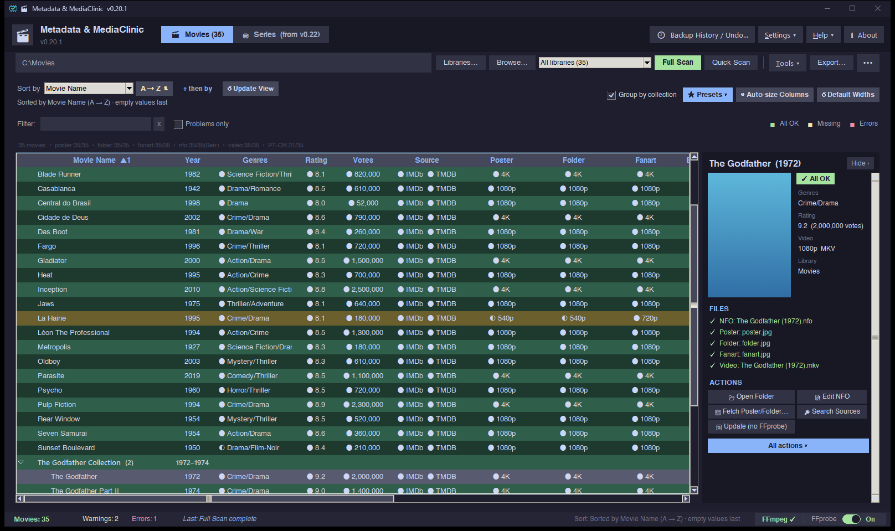
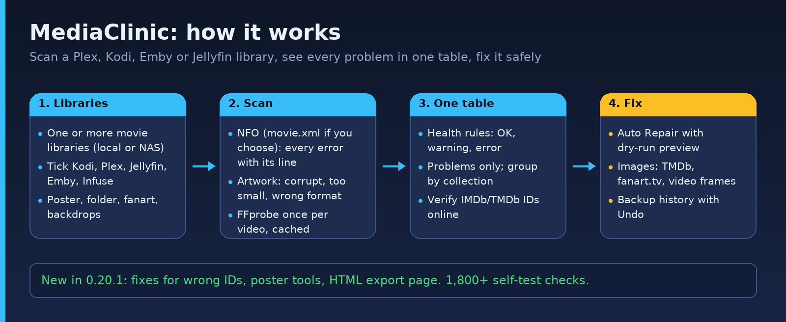

# MediaClinic

**A library health tool for Plex, Kodi, Emby and Jellyfin users: scan your offline movie library, find broken or incomplete metadata and artwork, and fix them.**

[](LICENSE)   [](https://github.com/junqueirach/mediaclinic/actions/workflows/ci.yml)

<p align="center"></p>

**Download for Windows:** get `MediaClinic-0.20.1-win64.zip` (about 35 MB) from the [latest release](https://github.com/junqueirach/mediaclinic/releases/latest). Unzip it to a folder you can write to (not `C:\Program Files`), open the `MediaClinic` folder and double-click `MediaClinic.exe`. No Python needed. The SHA-256 checksum is in the release notes.

**New in v0.20.1:** warnings that say what to do, and a fix behind every one. A TMDB number in an IMDb field (Emby and FileBot write this) is one clear warning with the right ID, and **Fix Wrong IMDb / TMDB IDs** corrects it for one movie, a selection or the whole library without adding a tag. The **Tools menu is grouped** (Reports, IDs, Ratings & Genres, Collections, NFO & File Names, Artwork), with **Fix one issue — All Movies**, **Add `<uniqueid>` for Kodi**, a tick box per Auto Repair step, and Pause in the bulk tools. Posters: **Replace Low-Resolution Posters**, **Review Posters One by One** and an artwork language setting. For Kodi: actor photos in `.actors`, an Extra art column and `set.nfo` for collections (Fix Collection writes it too, and a collection can be refreshed). **You see when the app is working:** while it writes or reads files again, a ring turns on the poster of the movie or collection, a thin bar moves above the table and the status bar says what it does, then ✓ Done or ! Not done. **Auto Repair says what it does** ("Fix 3 of 5 at once", with the fixes named), and the text in every window breaks to the window's width. The **HTML export** is a new page with five layouts, six themes, search, filters and a phone layout. Keyboard shortcuts for the everyday actions (Alt+P, Alt+I, F3, Ctrl+Z …; *Help → Shortcuts*), a Help that is easier to read, and three fixes from a tester with a NAS: Check for Updates from the Help window, the start-up after an update, and the program ending completely when you close it. The default for ID tags in the NFO is now `<uniqueid>` only. See the [changelog](CHANGELOG.md).

**In v0.20.0:** the whole app in English, Portuguese (Brazil) and Spanish (*Settings → User Interface → Interface language*). Health presets (Easy / Medium / Tight) set every rule at once. The checks follow what Kodi really reads (`<uniqueid>`, multi-part movies such as `Movie-CD1.mkv` + `Movie-CD2.mkv` with `Movie.nfo`, a folder's only NFO), and a tag holding something that is not an ID is reported and repaired. New tools: remove the online artwork links from an NFO (only for artwork you have as files), check your genres against TMDB, export the movie list as one HTML page with poster thumbnails, and turn a library off without removing it. If you trim your NFOs by hand, *Settings → Health Rules → NFO → ID tags written in the NFO → <uniqueid> only* keeps the app from adding other ID tags. **Tick the programs that play your movies** (Kodi, Plex, Jellyfin, Emby, Infuse, MediaBrowser / Media Center Master): the checks and the file names a fix writes follow them, based on tests on real Plex, Emby and Jellyfin servers and Infuse on an Apple TV; **Rename Files for My Programs** and **Convert movie.xml → NFO** do the switch for you, with Undo. A one-page window at the first start asks for the language, your movies folder, your programs, the strictness and FFprobe. Many fixes from the Reddit testers.

> **Windows SmartScreen:** the file is not code-signed, so Windows may show "Windows protected your PC". Click **More info**, then **Run anyway**. You can also run the app from source (see Quick start) and read every line of the code first.
>
> **VirusTotal:** a tester found two engines flagging the earlier exe with generic names. The flagged part was the PyInstaller loader that every Python exe built that way starts with, not the app: its code was byte-identical to the loader published on PyPI, the archive held only Python's standard library, the app's own modules, Pillow and openpyxl, and VirusTotal's sandboxes saw no network traffic or dropped files. Since the third build of v0.19.5 the exe is compiled with Nuitka (the Python code becomes C), which has no such loader: that build scored 0 of 69 on VirusTotal, the v0.19.6 exe 0 of 71, the v0.20.0 exe 0 of 70 and the v0.20.1 exe 0 of 62. The release notes carry the SHA-256 of the zip and of the exe.

## Why MediaClinic exists

MediaClinic is a **library management tool**: it scans your movie library, finds what is wrong, and repairs what it can. It works on the files in your movie folders (the `.nfo` and `movie.xml` metadata, the artwork and the video's own tags), so it does not matter whether Kodi, Plex, Emby, Jellyfin or Infuse plays them. It is not a scraper and it never opens a media server's database.

**Why a library needs managing.** With a streaming service such as Netflix, the company looks after the catalogue: every title has its artwork, description, genres and ratings, and someone keeps them right. A library of your own has no one doing that. Its metadata comes from scrapers, from different programs over the years and from your own edits, and these are the problems that build up:

- **Missing or wrong IDs.** An IMDb or TMDb ID that points to another film, an ID in the wrong tag (a TMDB number in an IMDb tag), an ID only one file has, or one a program cannot read (Kodi reads `<uniqueid>`; some old programs read only `movie.xml`). The server then matches the wrong film, or none.
- **Inconsistent metadata.** Genres merged into one tag (`Family/Fantasy`) or non-standard, a rating with 0 votes, a missing year, a title that differs between the NFO and the XML, collections named in different ways, a bare `&` that breaks the file, web links left in the NFO by a scraper.
- **Names and formats that not every program reads.** Kodi, Plex, Emby, Jellyfin and Infuse read different NFO and artwork names, and older Windows media centers read `movie.xml` instead of an NFO. A movie can look complete in one program and incomplete in another.
- **Artwork that is missing, corrupt, too small or in the wrong proportions.** On a high-definition TV a low-resolution poster or fanart is scaled up and looks soft or pixelated, and a library full of them looks poor even when the metadata is perfect.
- **Duplicates, and folders that are not movies.** The same film twice, or series, empty folders and loose files mixed into a movie library.
- **Edits nobody remembers.** Scraper bugs and hand edits make it impossible to know which of your hundreds or thousands of movies are still consistent.

The result is a library that can look fine on screen while the files underneath are not, and an experience that is less than ideal: wrong matches, missing or blurry artwork, odd genres and ratings, movies that appear differently in different programs. MediaClinic shows every such problem across the whole library at once, so you manage it as a whole instead of opening folders one by one. The scan only reads; nothing is written until you run a fix, every NFO/XML is backed up first, and every check is a rule you can switch off, so it does not object to a field you trimmed on purpose.

### What it fixes, by problem

- **Wrong or missing IDs**
  - **Verify IMDb/TMDb IDs** against TMDb (title in any translation, year ±1) with a sortable report
  - **Fix Wrong IMDb / TMDB IDs**: a TMDB number in an IMDb field (Emby and FileBot write this) is one warning that names the right ID; the fix replaces only the wrong values in the tags the file already has, from the same file or from TMDB, for one movie, a selection or the whole library
  - **Add `<uniqueid>` for Kodi**: adds only the `<uniqueid>` lines Kodi reads and leaves every other tag as it is
  - **Enter ID…**: type an IMDb or TMDb ID by hand, check the film it points to, and write it to the NFO (and `movie.xml` when it is used); a page address or an IMDb number without `tt` is cleaned
  - **Auto Repair** writes the IDs, including the `<uniqueid>` tags Kodi reads and the `movie.xml` ID tags old programs read
- **Inconsistent metadata**
  - **Normalize Genres** and **Normalize Sources**: written to the NFO and, when it is used, the `movie.xml`; movies without genres can get them from TMDb or OMDb after a preview; **Check Genres Against TMDB** lists the movies whose genres differ from TMDB's and writes TMDB's only for the ones you tick
  - **Sync Ratings** from TMDb and OMDb (you supply your own free API keys); a movie with only an IMDb ID is looked up on TMDb by that ID, and the end message names any movie that was skipped and why
  - **Make titles the same** (NFO and XML) and rename an NFO to the name Kodi expects, with a preview for the whole library
  - **Remove online artwork links** from the NFO: the web addresses scrapers leave in `<thumb>` tags are removed only for the artwork the folder has as a file, after a count; actor images and every other tag stay
  - **Movie collections**: a *Group by collection* view with one row per collection, *Check Collections Online* (TMDB), Fix, Set, Rename, Join and Remove from Collection, *Collection Artwork* to choose the set's poster and fanart, and Kodi's movie set information folder; a renamed collection takes its folder and images along, and Undo puts everything back
  - **Auto Repair** for one movie, a selection or the whole library, with a dry-run preview: IDs, ratings, genres, year, titles, collections and a bare `&` in the NFO; a movie's own artwork is never touched
  - **Fix one issue — All Movies**: runs one automatic fix on every movie that needs it; Auto Repair has a tick box per step, and the bulk tools can be paused
  - **set.nfo for Kodi collections**: checked, written with each new collection folder and by Fix Collection, with a Fix button beside the warning and *Check / Write set.nfo* for one collection or all; *Refresh Collection* reads a collection again
- **Names and formats that not every program reads**
  - **Rename Files for My Programs**: gives the NFO, poster and fanart the names every ticked program reads (for example `movie.nfo` → `<video>.nfo` for Infuse), with a preview, a backup and Undo; the video is never renamed
  - **Convert movie.xml → NFO**: for movies that have only a Media Center Master / MediaBrowser `movie.xml`, writes an NFO with title, year, rating, IDs, actors and genres; `movie.xml` stays, Undo removes the NFO
  - **Copy poster.jpg → folder.jpg** where the two differ, for one movie, a selection or the whole library
- **Artwork**
  - **Fetch Poster, Fanart and Backdrops** from TMDB or fanart.tv with thumbnails, or pick **frames from the video** with FFmpeg; new files follow the folder's naming style (Kodi or Emby)
  - **Fix image proportions / size**: for one movie or a batch, with a before/after preview and a backup first; an optional AI upscale is downloaded on request and checked by SHA-256
  - **Replace Low-Resolution Posters** with the best online poster in your artwork language, and **Review Posters One by One**: per movie, use an online poster, fix the proportions or upscale, with one Undo for the session
  - **Actor photos for Kodi**: *Download Actor Photos* into `.actors`, with the file names Kodi looks for; an Extra art column (clear logo, disc art, banner …) and *Convert extrafanart → fanart1, 2…*
- **Duplicates and folders that are not movies**
  - A Duplicate Movies Report, **Not a duplicate** marks for movies wrongly flagged, and an "Ignored folders" window for what is not a movie
- **Finding the problems in a large library**
  - A health table with a **panel for the selected movie** (poster, its issues with Fix buttons, files and actions; Ctrl+B hides it), clickable Errors/Warnings counters, *Problems only*, a column chooser, Library Statistics, parallel scanning and a Quick Scan that re-reads only what changed
  - **Sort builder** with up to three levels, presets, and the sort kept between sessions
  - **Several libraries** in one table (*Libraries…* dialog and library filter); an offline drive keeps its cached rows; a library can be turned off without removing it (not scanned, hidden, kept); Kodi's collection folder is set in the same window
  - **Export Movie List** to CSV, text, Excel or one self-contained HTML page (five layouts, six themes, search, filters, a detail view; posters inside the file, in a folder, as links or none), with column presets (including *Identify*: IMDB and TMDB links plus outline) and the option to export only the filtered view
- **Safe edits**
  - **Backup History / Undo**: every backup records what it changed, and a whole run can be restored
  - Every NFO/XML is backed up silently and written atomically, TMDb/OMDb calls are rate-limited and retried, API keys are kept out of the log, with automatic backup folder maintenance; rows refresh automatically after each change, and an activity indicator (a ring on the poster, a bar above the table, a status line) shows the write and the refresh until they are done
  - Keyboard shortcuts for the everyday actions (a Shortcuts tab in the Help lists them), jump-to-letter, sortable columns, remembered window sizes and positions, rotating logs

See [What it checks](#what-it-checks) for every rule behind these findings.

## How it works

<p align="center"></p>

MediaClinic expects one subfolder per movie, the layout used by Plex, Kodi, Emby and Jellyfin (movie folders inside other folders are found too, up to five levels deep). It checks the `.nfo` files that Kodi, Jellyfin, Emby and Infuse read, and the artwork every one of them reads. You tick the programs you use at the first start, or later under *Settings → Health Rules → Which programs play your movies?*; the ticks decide which files are checked (NFO, `movie.xml` of old Windows media centers such as MediaBrowser and Media Center Master, or both) and the names a fix writes, and a library played by other programs can have its own choice. It checks every artwork file, metadata file and video, and shows one colour-coded health table, red for errors and yellow for warnings. From the same table you can repair the common problems in place.

## What each program really reads

Checked in November 2026 with marked test files on real servers (Plex, Emby, Jellyfin) and Infuse on an Apple TV, and against each program's documentation:

| | Kodi | Plex | Emby | Jellyfin | Infuse |
|---|---|---|---|---|---|
| NFO | `<video>.nfo` (recommended); `movie.nfo` with *Movies are in separate folders* | **none** (title and plot come from online) | `<video>.nfo`, `movie.nfo` | `<video>.nfo`, `movie.nfo` | `<video>.nfo` only |
| Collections from the NFO (`<set>`) | yes | no | yes | yes, with *Automatically add to collection* | not tested (TMDB's, per Firecore) |
| Artwork | `<video>-poster.jpg` / `-fanart.jpg`; `poster.jpg` / `fanart.jpg` with *separate folders* | every usual name | every usual name | every usual name | `<video>-poster.jpg`, `poster.jpg`, `fanart.jpg` …; any other picture becomes the poster when none of those exists |

With only Plex ticked, MediaClinic asks once whether to switch its NFO and collection checks off. Artwork named the Kodi way shows correctly in all five; for Infuse the NFO must be named `<video>.nfo`. Infuse's collections were not tested (Firecore says it uses TMDB's).

## MediaClinic, MediaElch and tinyMediaManager

MediaClinic does not replace MediaElch or tinyMediaManager; it works next to them.

- **MediaElch and tinyMediaManager are scrapers and editors.** You point them at a movie, they fetch metadata and artwork from TMDB, IMDb and others, and write the NFO and the images. If one of them works for you, keep using it.
- **MediaClinic audits and repairs a library that already exists.** It scans the whole library, gives every movie a health result and shows what is wrong across everything at once: missing or broken NFO / `movie.xml` files, missing IDs, missing or small artwork, wrong image proportions, folder names that do not match, missing audio or subtitle languages, non-standard genres. Then it fixes what it can in batches, with a backup first.

It is most useful on a large library built over years with different tools: it tells you which 40 of your 2,000 movies are incomplete without opening them one by one. Fix those in your scraper, or in MediaClinic for the simpler cases. The scan only reads; nothing is written until you run a fix, and every rule can be switched off.

## What it checks

| Area | Checks |
|---|---|
| Artwork | `poster.jpg`, `folder.jpg`, `fanart.jpg` (or the Kodi names `<video>-poster.jpg`, `<video>-fanart.jpg`, `.png`, `.tbn`) present, decodable (corrupt kept apart from too small), right proportions, minimum resolution tier (4K to 360p), minimum file size, file format matching the extension; clear logo and disc art (Tight preset); web links in the NFO for artwork you already have as files (off unless you turn it on) |
| Backdrops | `backdrop.jpg`, `backdrop1.jpg` and so on, plus Kodi extra fanart (`fanart1.jpg`, `extrafanart/`): count and average size |
| Metadata | `MovieName.nfo` or `movie.nfo` and, if your health mode uses it, `movie.xml`: present and well-formed; every error is listed with its line and tag name. DVD and Blu-ray folders (`VIDEO_TS`, `BDMV`) count as one movie. Every name that Kodi, Jellyfin, Emby and Plex read is recognised; folders that hold other movie folders are walked into (five levels), and folders that are not movies (TV series, empty folders) get no row and are listed in an "Ignored folders" window |
| Identity | IMDB and TMDB IDs across all NFO/XML tags: missing, empty, conflicting, or present in one file only; an ID Kodi cannot read (only in `<imdbid>` / `<tmdbid>`, not in `<uniqueid>`) or that old `movie.xml` readers ignore; a tag that holds something that is not an ID (a TMDB number in an IMDb tag); duplicate movies (same ID, or same title and year, in another folder, also across libraries); optional online check that the IDs point to the right film |
| Collections | The collection of each movie in the NFO (and `movie.xml` when it is used): the two files agree, the name matches TMDB, the set folder has its poster and fanart. One name per collection: English, unless more than half of its titles are in another language, or a language you fix in Settings |
| Ratings, titles, year | Rating and votes (legacy tags and Kodi v17+ `<ratings>` blocks), NFO title against XML local title (when both are used), missing year |
| Genres | Non-standard genres, synonyms, merged tags such as `Family/Fantasy`, translations from eight languages, genres present in only one of NFO and XML (when both are used) |
| Video (FFprobe) | Resolution class, audio tracks and languages, embedded subtitles, hard-coded subtitles you mark by hand, required language. *Language OK* counts audio and subtitle tracks only: the metadata language tags of the NFO and XML do not count. One probe per video, cached |

Every check is a **health rule** you can switch on or off, or tune, in *Settings → Health Rules*, in four parts: general rules, NFO rules, `movie.xml` rules and NFO-against-`movie.xml` comparisons. Parts your health mode does not use stay visible but grayed. Three presets set them all at once: **Easy** (only what Kodi needs to show and play the movie), **Medium** (plus a clean library: ratings, IDs, 720p) and **Tight** (everything the app checks, 1080p; a new user starts here). Changing a rule by hand shows *Custom*.

## Quick start

From the Windows download, just run `MediaClinic.exe`. From source:

```
pip install -r requirements.txt     # optional: pillow, openpyxl
python mediaclinic.py
```

**Linux and macOS:** there is no download yet, but the app runs from source, and the test suite runs on Ubuntu in CI. On Debian or Ubuntu install `python3-tk python3-venv ffmpeg xdg-utils fonts-noto-color-emoji` (on macOS, a Python with Tk and `ffmpeg` from Homebrew), then:

```
git clone https://github.com/junqueirach/mediaclinic
cd mediaclinic
python3 -m venv .venv && .venv/bin/pip install pillow openpyxl
sh MediaClinic.sh
```

`MediaClinic.sh` says what is missing if Tk, Pillow or openpyxl is not installed. Settings go to `~/.config/MediaMetadataClinic/`. Where your Kodi, Jellyfin, Emby or Plex runs does not matter: the app works on the files. Windows is tested by hand; v0.19.6 was also checked on Ubuntu (under WSL) and v0.20.0 was built and started there; macOS is not tested, so a note with `logs/app.log` helps if something looks off.

Run it from the folder that contains the `settings_*.py` files. FFmpeg and FFprobe are optional but recommended (point *Settings → Editor & FFmpeg* to their `bin` folder). Settings, your API keys and the last scan are stored in `%APPDATA%\MediaMetadataClinic\`, outside this repository, and since v0.19.4 so are the backups, so an update keeps Backup History and Undo (backups from an older version next to the program move there once). `logs/` is created next to the program. The full help is inside the app (F1).

## Interface language

The app speaks English, Portuguese (Brazil) and Spanish, including the Help and About. Until you choose, it follows the Windows display language: any Portuguese gives Portuguese (Brazil), any Spanish gives Spanish, everything else English. *Settings → User Interface → Interface language* changes it; the choice is saved at once and *Restart now* applies it.

Only what you read changes. The NFO and `movie.xml` files, `settings.json`, the backups and `logs/app.log` are written the same in every language, and the keyboard shortcuts stay the same. Exported lists and reports use the interface language for their headings and status words; the movie data in them does not change. "Full Scan" and "Quick Scan" keep their English names in all three languages.

The texts live in `mc_i18n.py` (one catalog per language), the Help in `help_text.py` (English), `help_pt_br.py` and `help_es.py`. A new text goes into all three languages; the self-test fails when one is missing. Corrections from native speakers are welcome as a GitHub issue.

## Engineering notes

This project is the clearest example of working with an AI under a written contract:

- [`docs/CLAUDE_RULES.md`](docs/CLAUDE_RULES.md) defines module boundaries, the save chain, naming rules and a safety checklist that every AI-edited change must respect
- `settings_schema.json` plus `tests/settings_test_harness.py` check the settings subsystem after every change
- `tests/selftest_v0_20_1.py` builds a synthetic library (NFO, XML, generated JPEGs and a real 3-second MKV) and runs about 1,800 end-to-end checks, from health rules to Auto Repair and the export dialogs (TMDb calls are simulated); it runs in CI under a virtual display (checks that need Windows, such as the registry, backslash paths and the AI upscaler, are skipped on Linux) and never touches your real settings
- The code is split into model, controller, context, dialog, export, help and genre-data modules so the AI can edit one part without breaking another
- About 55,500 lines of Python in 25 modules (the three Help languages and the text catalog `mc_i18n.py` among them); 41 versions in total, the earlier ones in `archive/versions/`, starting from a 12 KB folder scanner
- Changes per version are in [CHANGELOG.md](CHANGELOG.md)

---

## How this was built

Built with **Claude (Anthropic)** as the coding partner. I wrote the requirements and the revision prompts, tested every build on real data, and decided what to fix next. The `archive/versions/` folder keeps every earlier release so the iteration history is visible.

**Security note:** the app stores any API keys you enter in a local settings file outside this repository. `.gitignore` excludes config and settings files so keys are never committed.

## Contributing and security

See [CONTRIBUTING.md](CONTRIBUTING.md) and [SECURITY.md](SECURITY.md). Bug reports and ideas are welcome through the issue templates.

## Licence

MIT. See [LICENSE](LICENSE). This product uses the TMDB API but is not endorsed or certified by TMDB. OMDb data is subject to the [OMDb API terms](https://www.omdbapi.com/legal.htm). FFmpeg is a separate download under its own license.

## Author

Luiz Junqueira - [junqueira.ch](https://www.junqueira.ch) - [LinkedIn](https://www.linkedin.com/in/luizjunqueira/)
